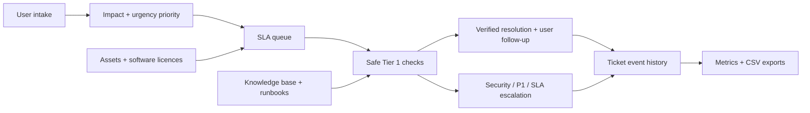

# Helpdesk Operations Lab

A small, working Tier 1 helpdesk lab built to practise the operating habits behind an internal service desk: clear intake, priority and SLA decisions, asset records, reproducible troubleshooting, knowledge-base use, security escalation, and user follow-up.

The incidents and assets in this repository are simulated. The lab does not claim production administration experience with Microsoft 365, Active Directory, Windows Server, Yealink phones, or other named platforms.

## What is included

- A SQLite-backed command-line ticket, asset, licence, and audit-event tracker
- 12 simulated incidents spanning Windows, Microsoft 365, Teams, SharePoint, printing, DNS/DHCP, AV/event support, onboarding, mobile devices, and malware response
- SLA dashboard logic for P1-P4 requests, including overdue, at-risk, security, and business-impact escalation flags
- Asset and software-license records for workstations, Macs, printers, tablets, projectors, and IP phones
- Five concise knowledge-base and runbook articles
- A read-only PowerShell workstation diagnostic collector for Windows
- Resolution controls that require meaningful notes and create a timestamped audit event
- Daily operational metrics and CSV exports for tickets, assets, licences, and event history
- Eight automated tests plus a GitHub Actions workflow

## Run the lab

The project uses only the Python standard library.

```bash
python3 helpdesk_lab.py init
python3 helpdesk_lab.py dashboard --as-of 2026-08-14T16:00:00
python3 helpdesk_lab.py metrics
python3 helpdesk_lab.py tickets
python3 helpdesk_lab.py assets
python3 helpdesk_lab.py kb "Teams microphone"
python3 helpdesk_lab.py resolve INC-1002 --notes "Selected the approved headset and confirmed a successful Teams test call."
python3 helpdesk_lab.py export --output-dir exports
python3 -m unittest discover -s tests -v
```

The database is created at `data/helpdesk_lab.db` and can be safely regenerated with `python3 helpdesk_lab.py init --reset`.

## Design overview



The project deliberately separates safe Tier 1 actions from privileged administration. Permission grants, destructive cleanup, broad network changes, account-compromise decisions, and security closure stay with an authorized owner. See [Design and Controls](docs/design-and-controls.md).

## Operating approach

1. Confirm the user, service, business impact, urgency, device, location, and exact symptom.
2. Record a reproducible description and assign priority from impact and urgency.
3. Check service status, known issues, recent changes, connectivity, identity/access, and device state.
4. Apply the least disruptive safe test, document results, and confirm resolution with the user.
5. Escalate early when there is security risk, broad impact, privileged access, data-loss risk, or an approaching SLA.

## Why this project is relevant

The value of the lab is not the list of product names. It demonstrates an operating model: capture enough information to reproduce an issue, set priority consistently, watch the SLA, choose low-risk diagnostic steps, document the outcome, confirm with the user, preserve an audit trail, and escalate when the Tier 1 boundary is reached.

## Limitations

- The data is synthetic and the platform runs locally.
- Microsoft 365, Active Directory, Windows Server, Yealink, and endpoint-management integrations are represented as support scenarios and documented boundaries, not production tenant administration.
- The PowerShell collector is intended for a Windows lab and is not executed by the cross-platform test suite.
