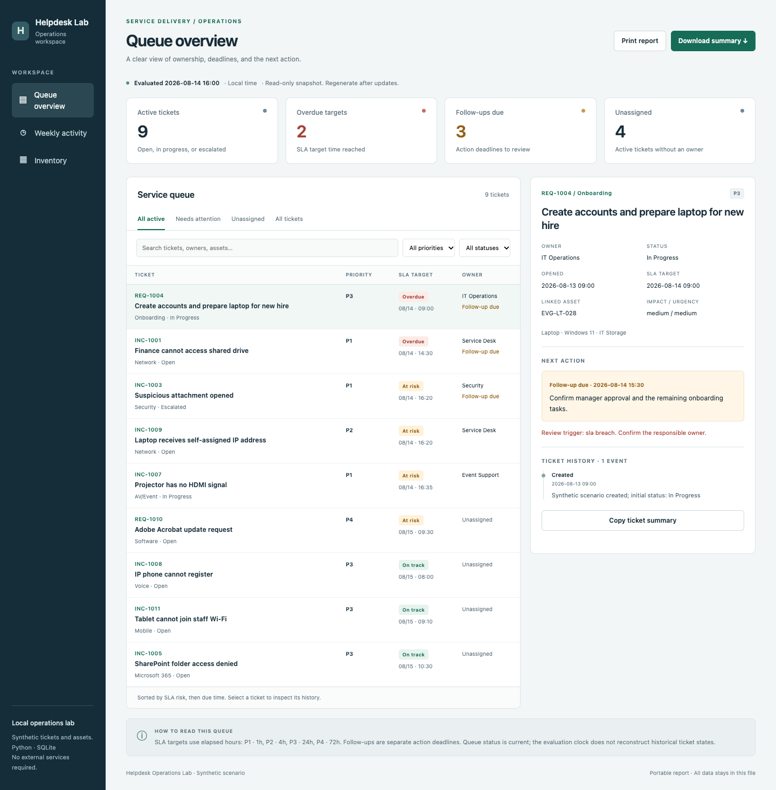

# Helpdesk Operations Lab

[](https://github.com/Volianwt/helpdesk-operations-lab/actions/workflows/tests.yml)

I built this local service-desk lab to work through a complete support workflow: triage a request, assign an owner, track the next action, document the outcome, and review the queue. It combines a Python command line, a SQLite database, and an offline dashboard that can be shared as a single HTML file.

All incidents, assets, and licence records are simulated.

## Preview



Download [the example dashboard](docs/demo-dashboard.html) and open it in a browser. The example uses a fixed review time of **August 14, 2026, at 16:00** so the SLA calculations are reproducible.

The dashboard includes queue totals, search, status and priority filters, attention flags, and a ticket detail view with event history. It is an exported snapshot; regenerate the file after changing a ticket.

The accompanying [weekly summary](docs/demo-weekly-summary.md) shows the queue and recorded activity in a format suitable for a handover or status review.

Rebuild both examples with `python3 scripts/build_demo.py`. The script applies four recorded changes to a temporary database, including a follow-up and a simulated resolution. It leaves the working database untouched.

## What the lab covers

| Area | Implementation |
| --- | --- |
| Triage | Impact and urgency determine P1–P4 priority; security, business impact, and SLA risk produce escalation flags. |
| Queue ownership | Tickets carry an owner, a follow-up deadline, and notes for the next action. |
| Ticket history | Updates, notes, and resolutions create timestamped events. Resolution requires an outcome note. |
| Reporting | A standalone HTML dashboard, a seven-day Markdown review, and CSV exports. |
| Inventory | Device assignment, repair status, software seats, and renewal dates. |
| Troubleshooting | Five support runbooks and a PowerShell workstation diagnostic collector. |

The sample queue contains 12 incidents and requests covering connectivity, Microsoft 365, printing, AV support, onboarding, offboarding, and security escalation.

## Run locally

Use Python 3.10 or later. There are no third-party Python dependencies.

```bash
python3 helpdesk_lab.py init
python3 helpdesk_lab.py report --as-of 2026-08-14T16:00:00 --output reports/dashboard.html
python3 helpdesk_lab.py weekly --as-of 2026-08-14T16:00:00 --output reports/weekly-summary.md
```

Open `reports/dashboard.html` in a browser and `reports/weekly-summary.md` in a Markdown viewer. No server is required.

The default database is `data/helpdesk_lab.db`. Running `init` again preserves existing records and applies any additive schema updates. To use a separate database, put `--db` before the command:

```bash
python3 helpdesk_lab.py --db data/practice.db init
python3 helpdesk_lab.py --db data/practice.db dashboard --as-of 2026-08-14T16:00:00
```

**`init --reset` deletes the selected database and replaces it with the sample records.** Use it only when you want to discard your local changes.

## Work through a ticket

Assign the meeting-audio incident and record the next action:

```bash
python3 helpdesk_lab.py update INC-1002 \
  --owner "Service Desk" \
  --status "In Progress" \
  --follow-up-due 2026-08-14T17:00:00 \
  --notes "Confirm headset selection and run a Teams test call." \
  --at 2026-08-14T16:05:00
```

Add a progress note, then resolve the incident after verification:

```bash
python3 helpdesk_lab.py note INC-1002 \
  --notes "Selected the approved headset. Waiting for the user to join the test call." \
  --at 2026-08-14T16:10:00

python3 helpdesk_lab.py resolve INC-1002 \
  --notes "Completed a Teams test call; the user confirmed microphone input and playback." \
  --at 2026-08-14T16:20:00

python3 helpdesk_lab.py report --as-of 2026-08-14T16:30:00 --output reports/dashboard.html
python3 helpdesk_lab.py weekly --as-of 2026-08-14T16:30:00 --output reports/weekly-summary.md
```

The fixed timestamps keep the walkthrough on the sample data's clock. Start with a fresh practice database if you have already resolved `INC-1002`. Omit `--at` and `--as-of` to use the current local time. Timestamps must be local ISO dates and times without a timezone suffix.

`--as-of` sets the reference time for SLA calculations and reporting windows. Reports always use the **current stored ticket status**; they do not reconstruct an earlier version of the queue. The review time cannot precede a ticket's opening time.

## Other commands

```bash
python3 helpdesk_lab.py tickets
python3 helpdesk_lab.py dashboard --as-of 2026-08-14T16:00:00
python3 helpdesk_lab.py metrics --as-of 2026-08-14T16:00:00
python3 helpdesk_lab.py assets
python3 helpdesk_lab.py kb "Teams microphone"
python3 helpdesk_lab.py export --output-dir exports
python3 -m unittest discover -s tests -v
```

The PowerShell collector is in [`powershell/Collect-WorkstationDiagnostics.ps1`](powershell/Collect-WorkstationDiagnostics.ps1). It gathers workstation information and writes a text report; it does not change workstation settings. It requires Windows and is separate from the cross-platform Python test suite.

## Design choices

I chose SQLite to keep setup small and make the records easy to inspect. HTML, Markdown, and CSV exports make the output useful without requiring another person to install the application. The CLI remains the place to change records; the dashboard is a read-only review surface.

The SLA targets are simplified elapsed-hour rules for the lab. There is no business-hours calendar, authenticated technician identity, or live connection to Microsoft 365 or device-management platforms. The runbooks distinguish routine diagnostic work from actions that need an authorized service or security owner.

See [design and controls](docs/design-and-controls.md) for the data model, reporting assumptions, and validation approach.
